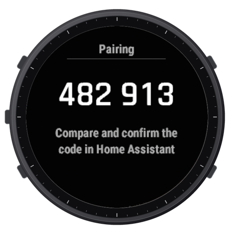
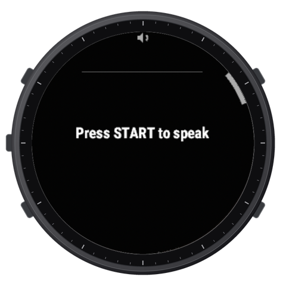
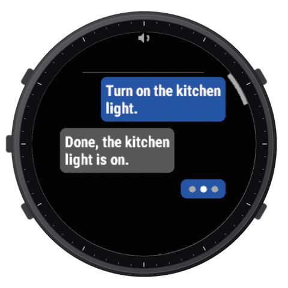
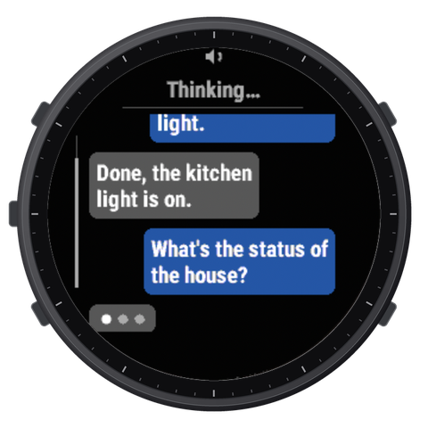
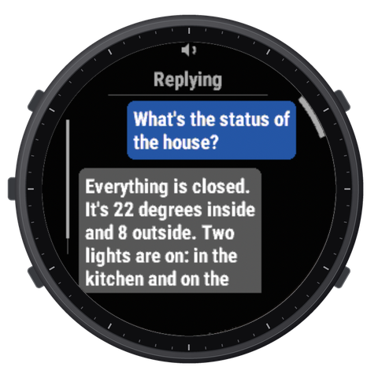
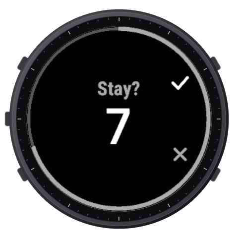

**Talk to Home Assistant from your Garmin watch.**

## How it works

1. Press START and say a command.
2. Your Home Assistant understands it and acts.
3. The watch shows the reply and speaks it.

## On the watch

Pair the watch once with a code you confirm in Home Assistant. Press START, say a command, and read
the reply in a chat view - long conversations scroll with a finger or the buttons.

## What you need

- Home Assistant with Assist, reachable over HTTPS (for example with Home Assistant Cloud).
- A Garmin watch with a microphone and a speaker - the first version supports the fēnix 8 Solar
  51 mm.
- Your phone with Garmin Connect nearby: the watch talks to Home Assistant through it.

## Get it

| What you need | What to do |
|---|---|
| **Home Assistant integration** - [ha-wristtalk](https://github.com/grzegorz-krzyzak/ha-wristtalk#readme) | Install it first, with [HACS](https://hacs.xyz/) |
| **Watch app** - [garmin-wristtalk](https://github.com/grzegorz-krzyzak/garmin-wristtalk#readme) | From the Connect IQ store - coming |

## Privacy

Your voice goes only to your own Home Assistant. Read the [privacy policy](privacy/).
